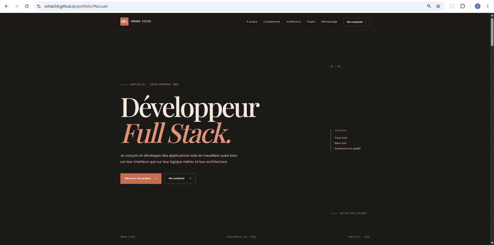

# 👋 Portfolio - Orhan CICEK

**Développeur Full Stack** — PHP • Java • Spring Boot • MySQL • HTML • CSS • JavaScript

Bienvenue sur mon portfolio ! Ce site présente mon parcours, mes compétences techniques, mon CV ainsi qu'une sélection de projets réalisés au cours de mes formations et de mes expériences en développement web et logiciel.

🔗 **Portfolio en ligne :** [orhan54.github.io/portfolio](https://orhan54.github.io/portfolio/)

💻 **Code source :** [github.com/orhan54](https://github.com/orhan54)

---

## 🧭 Sommaire

- [À propos](#-à-propos)
- [Aperçu du portfolio](#-aperçu-du-portfolio)
- [Projets](#-projets)
  - [1. Kebab O'Delices — Site vitrine et menu interactif](#1-kebab-odelices--site-vitrine-et-menu-interactif)
  - [2. Vacances — Application Full Stack](#2-vacances--application-full-stack)
  - [3. Mon CV](#3-mon-cv)
  - [4. Site pizzeria](#4-site-pizzeria)
  - [5. Calculatrice](#5-calculatrice)
  - [6. Site de supercars](#6-site-de-supercars)
- [Technologies et compétences](#-technologies-et-compétences)
- [Architecture et conception](#-architecture-et-conception)
- [DevOps, CI/CD et qualité](#-devops-cicd-et-qualité)
- [Structure du dépôt](#-structure-du-dépôt)
- [Installation et lancement](#-installation-et-lancement)
- [Contact](#-contact)

---

## 🎯 À propos

Je m'appelle **Orhan CICEK** et je code depuis 2023.

Titulaire d'une formation de **Concepteur Développeur d'Applications**, je suis intéressé par le développement web et logiciel, aussi bien côté front-end que back-end.

Au cours de mes formations et de mes projets, j'ai travaillé avec plusieurs technologies et langages : **HTML, CSS, JavaScript, PHP, Java et SQL**.

J'ai également acquis des connaissances en programmation orientée objet, architecture MVC, DAO, gestion des entités, développement d'API REST et bases de données relationnelles.

Mon parcours m'a aussi permis d'aborder les environnements de développement, les tests automatisés, la conteneurisation avec Docker et les pratiques d'intégration continue (CI/CD).

Mon objectif est de continuer à développer mes compétences et d'évoluer sur des projets orientés **développement Full Stack, conception logicielle et qualité du code**.

---

## 🖼️ Aperçu du portfolio

Voici un aperçu de la page d'accueil de mon portfolio :



Le portfolio présente mon parcours, mes compétences techniques et plusieurs réalisations. Chaque projet dispose d'une description, des technologies utilisées et, lorsque disponible, d'un accès à sa version en ligne et à son code source.

---

## 📂 Projets

### 1. Kebab O'Delices — Site vitrine et menu interactif

Site web responsive réalisé pour un restaurant, permettant aux clients de consulter facilement le menu, les produits, leurs descriptions et leurs tarifs.

Le projet intègre une gestion dynamique du menu grâce à deux fichiers Google Sheets, permettant de mettre à jour les produits, les descriptions et les prix sans avoir à modifier le code source du site.

L'application intègre notamment :

- Menu interactif avec affichage des produits et de leurs tarifs.
- Gestion dynamique du contenu depuis Google Sheets.
- Organisation des produits par catégories.
- Présentation des nouveautés et des offres.
- Gestion des suppléments et des sauces.
- Affichage des horaires d'ouverture et des exceptions.
- Accès rapide aux commandes par téléphone et WhatsApp.
- Interface responsive adaptée aux ordinateurs et aux mobiles.

Le site est déployé sur **Vercel**, afin de rendre le projet accessible depuis un navigateur.

**Technologies :** `HTML5` `CSS3` `JavaScript` `Google Sheets`

**Hébergement :** `Vercel`

**Application en ligne :** https://odelices-pi.vercel.app/

---

### 2. Vacances — Application Full Stack

Application web **Full Stack PHP/MySQL** permettant de gérer des lieux de vacances, leurs disponibilités et les réservations des utilisateurs.

Le projet met en œuvre une architecture **MVC développée sans framework**, avec une séparation claire entre les contrôleurs, les entités et les DAO.

Les échanges avec la base de données sont réalisés avec **PDO et des requêtes préparées**.

L'application intègre notamment :

- Authentification des utilisateurs.
- Gestion des rôles utilisateur et administrateur.
- Gestion des lieux et de leurs disponibilités.
- Réservations.
- Commentaires et notes.
- Likes.
- Interface d'administration.

Le projet est déployé sur **AwardSpace**, avec une base de données MySQL hébergée, afin de rendre l'application accessible depuis un navigateur.

**Technologies :** `PHP` `MySQL` `Tailwind CSS` `JavaScript` `MVC` `DAO` `PDO` `Flatpickr`

**Hébergement :** `AwardSpace`

**Application en ligne :** https://vacancesapp.atwebpages.com/

**Code source :** https://github.com/orhan54/vacances

---

### 3. Mon CV

CV interactif réalisé en HTML et CSS, avec un design moderne et responsive.

Il présente mon parcours professionnel, mes formations, mes compétences techniques ainsi que mes expériences dans le développement web et logiciel.

**Technologies :** `HTML5` `CSS3`

---

### 4. Site pizzeria

Site vitrine moderne pour une pizzeria, réalisé en HTML, CSS et JavaScript.

Le projet propose notamment un menu interactif, une présentation des produits et différentes interactions JavaScript.

Les données du menu sont également organisées à l'aide de fichiers JSON.

Le site est responsive afin de proposer une expérience adaptée aux différents écrans.

**Technologies :** `HTML5` `CSS3` `JavaScript` `JSON`

---

### 5. Calculatrice

Calculatrice interactive réalisée en HTML, CSS et JavaScript.

Elle permet d'effectuer les principales opérations mathématiques :

- Addition
- Soustraction
- Multiplication
- Division

Ce projet permet notamment de mettre en pratique la manipulation du DOM, les événements JavaScript et la gestion de la logique applicative côté client.

**Technologies :** `HTML5` `CSS3` `JavaScript`

---

### 6. Site de supercars

Plateforme web dédiée aux passionnés d'automobiles d'exception.

Le site présente une sélection de supercars avec leurs caractéristiques techniques, leurs performances et différents éléments visuels permettant de découvrir l'univers des voitures de sport haut de gamme.

Le projet est principalement orienté intégration HTML/CSS et mise en valeur du contenu à travers une interface visuelle.

**Technologies :** `HTML5` `CSS3`

---

## 🛠️ Technologies et compétences

Les technologies suivantes ont été abordées et utilisées au cours de mes formations et de mes projets.

### Front-End

| Technologie  | Utilisation                                   |
| ------------ | --------------------------------------------- |
| HTML5        | Structure et organisation des pages           |
| CSS3         | Mise en page, responsive design et animations |
| JavaScript   | Interactivité et logique côté client          |
| Bootstrap    | Framework CSS pour la création d'interfaces   |
| Tailwind CSS | Framework CSS utilitaire                      |

### Back-End

| Technologie | Utilisation                                            |
| ----------- | ------------------------------------------------------ |
| PHP         | Développement back-end et logique applicative          |
| Java        | Programmation orientée objet et développement logiciel |
| Spring Boot | Développement back-end avec Java                       |
| Symfony     | Framework PHP                                          |
| Laravel     | Framework PHP                                          |

### Bases de données et architecture

| Technologie / Concept | Utilisation                                |
| --------------------- | ------------------------------------------ |
| MySQL                 | Gestion de bases de données relationnelles |
| SQL                   | Requêtes et manipulation des données       |
| PDO                   | Accès aux bases de données en PHP          |
| POO                   | Programmation orientée objet               |
| MVC                   | Organisation de l'architecture applicative |
| DAO                   | Séparation de l'accès aux données          |
| Repository Pattern    | Organisation de la persistance des données |
| API REST              | Communication entre applications           |

---

## 🏗️ Architecture et conception

Les principes et concepts abordés dans mes projets et formations comprennent :

- **Programmation orientée objet (POO)** : classes, objets, encapsulation et séparation des responsabilités.
- **Architecture MVC** : séparation entre modèles, vues et contrôleurs.
- **DAO / Entités** : organisation de l'accès aux données et représentation des objets métier.
- **Repository Pattern** : centralisation des opérations de persistance.
- **API REST** : conception et communication avec des services web.
- **Spring Boot** : découverte de l'écosystème Java pour le développement back-end.

---

## ⚙️ DevOps, CI/CD et qualité

J'ai également découvert et utilisé différents outils permettant d'aborder l'automatisation des processus de développement, les tests et le contrôle de la qualité du code.

| Outil          | Utilisation                                             |
| -------------- | ------------------------------------------------------- |
| Git            | Gestion de versions                                     |
| GitHub         | Hébergement et gestion des dépôts                       |
| Docker         | Conteneurisation des applications                       |
| GitHub Actions | Automatisation des workflows et intégration continue    |
| Jenkins        | Automatisation des pipelines CI/CD                      |
| Maven          | Gestion des dépendances et construction de projets Java |
| JUnit          | Tests unitaires Java                                    |
| Allure Report  | Génération et visualisation des rapports de tests       |
| SonarQube      | Analyse statique et suivi de la qualité du code         |

Un pipeline CI/CD peut notamment intégrer les étapes suivantes :

1. Déclenchement d'un workflow lors d'un push ou d'une Pull Request.
2. Compilation et vérification du projet.
3. Exécution des tests automatisés.
4. Génération de rapports de tests.
5. Analyse de la qualité du code.

---

## 📁 Structure du dépôt

```text
portfolio/
│
├── index.html
├── README.md
│
└── public/
    │
    ├── css/
    │   ├── style.css
    │   ├── cv.css
    │   ├── pizza.css
    │   ├── calculatrice.css
    │   ├── corvette.css
    │   └── voiture.css
    │
    ├── js/
    │   └── index.js
    │
    ├── json/
    │   └── *.json
    │
    ├── images/
    │   ├── portfolio-preview.png
    │   └── ...
    │
    └── view/
        ├── fullstack/
        │   └── ...
        ├── cv/
        │   └── cv.html
        ├── pizza/
        │   └── ...
        ├── calculatrice/
        │   └── ...
        └── voiture/
            └── ...
```

---

## ⚙️ Installation et lancement

Pour consulter le portfolio et les projets front-end, aucune installation particulière n'est nécessaire.

Ces instructions concernent uniquement le portfolio. Les autres projets peuvent nécessiter des configurations et des environnements spécifiques.

### 1. Cloner le dépôt

```bash
git clone https://github.com/orhan54/portfolio.git
```

### 2. Accéder au dossier

```bash
cd portfolio
```

### 3. Lancer le projet

Ouvrir le fichier `index.html` dans un navigateur.

Il est également recommandé d'utiliser un serveur local, notamment pour les projets utilisant des fichiers JSON.

Avec l'extension **Live Server** de VS Code ou avec Python :

```bash
python -m http.server 8000
```

Puis accéder à :

```text
http://localhost:8000
```

---

## 📬 Contact

- **Email :** [orhancicek1985@gmail.com](mailto:orhancicek1985@gmail.com)
- **GitHub :** [github.com/orhan54](https://github.com/orhan54)
- **LinkedIn :** [linkedin.com/in/orhan-cicek-b40960260](https://www.linkedin.com/in/orhan-cicek-b40960260/)
- **Portfolio :** [orhan54.github.io/portfolio](https://orhan54.github.io/portfolio/)

---

<p align="center">
  Fait avec ❤️ par Orhan CICEK
</p>
